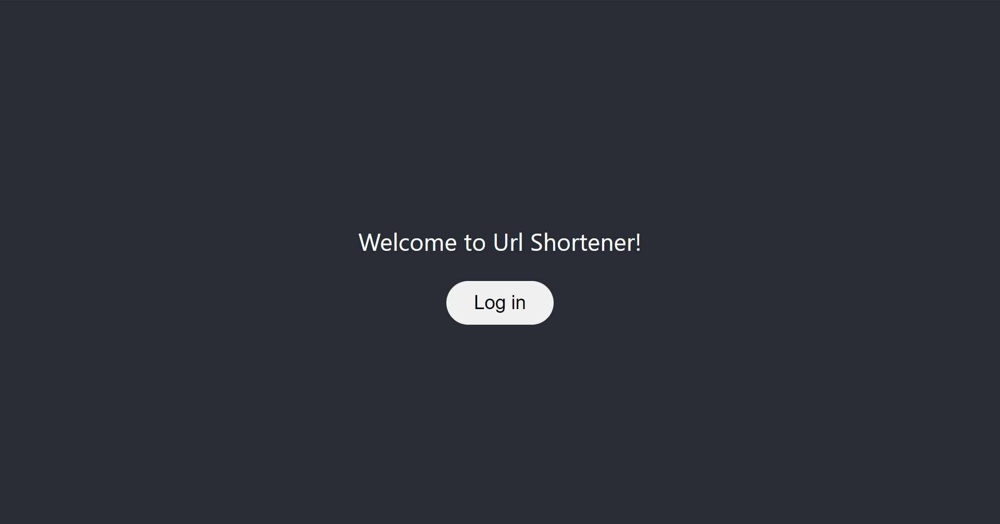
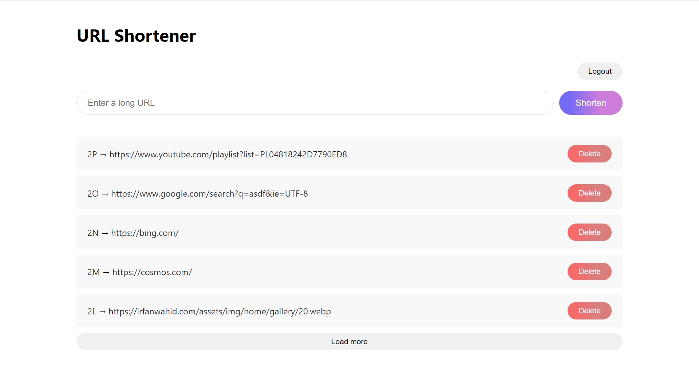
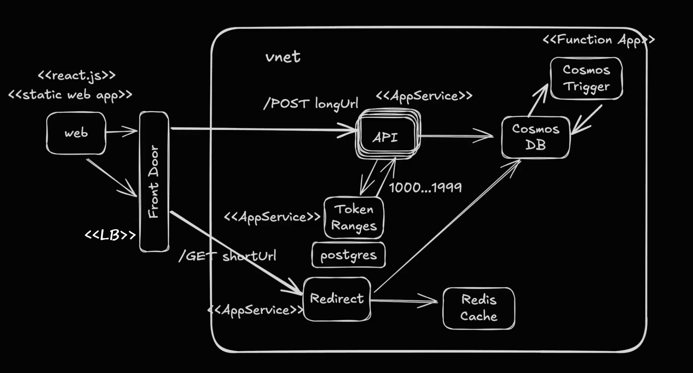
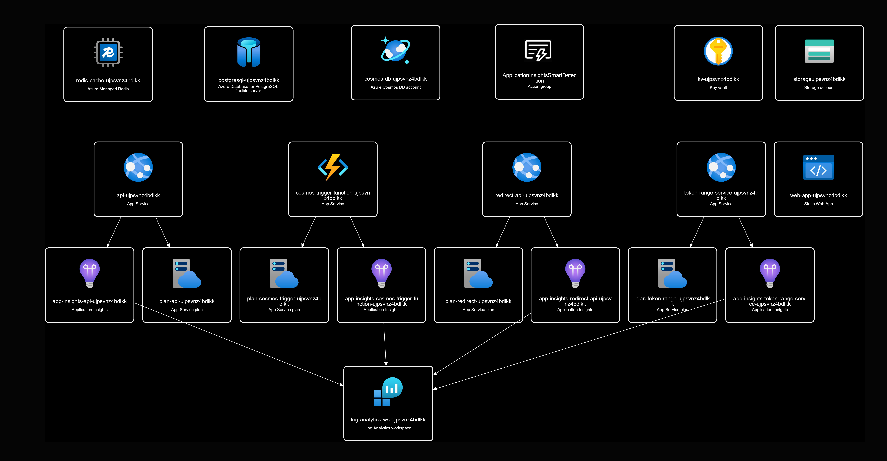
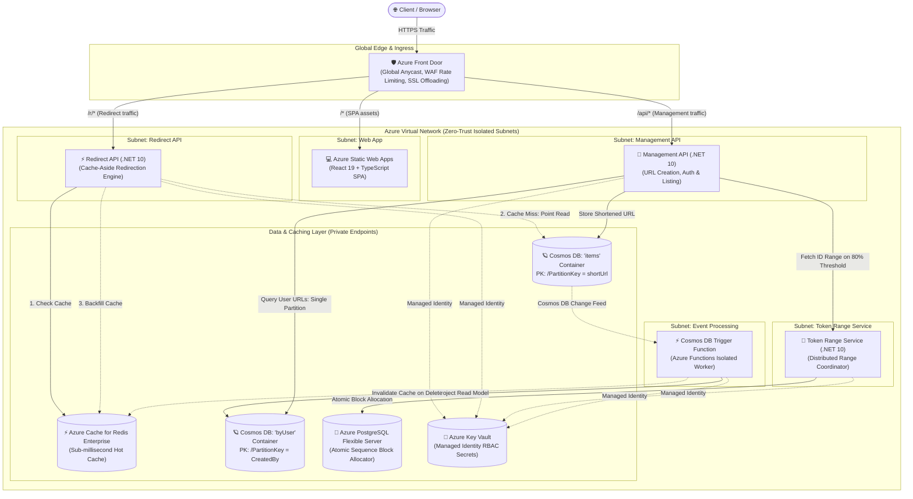

# 🚀 Distributed High-Traffic URL Shortener

[](https://dotnet.microsoft.com/)
[](https://learn.microsoft.com/en-us/azure/azure-resource-manager/bicep/)
[](https://azure.microsoft.com/en-us/products/cosmos-db/)
[](https://azure.microsoft.com/en-us/products/cache/)
[](https://azure.microsoft.com/en-us/products/frontdoor/)
[](https://react.dev/)
[](https://github.com/features/actions)

An enterprise-grade, cloud-native distributed URL shortener engineered to handle **massive, global-scale traffic** with an extreme read-to-write ratio (1000:1 read:write). Built on **.NET 10 Minimal APIs**, **Azure Cosmos DB**, **Azure Cache for Redis Enterprise**, and **Azure Front Door**, the system provides sub-millisecond redirection latencies, distributed sequence generation with zero locking, event-driven CQRS data projections, and a fully automated **Azure Bicep** Infrastructure-as-Code (IaC) deployment.

---

## 📸 Screenshots & Architecture Overviews

### Web Application Interface
The modern React 19 single-page application features Microsoft Entra ID (Azure AD) authentication, instant short link generation, clipboard copying, and user dashboard management.

| URL Shortening Dashboard | URL Analytics & Management |
| :---: | :---: |
|  |  |

### Azure Cloud Infrastructure & Services
Fully automated infrastructure provisioned via modular Azure Bicep templates into an isolated Azure Virtual Network with zero trust networking.

| Infrastructure Architecture Map |
| :---: |
|  |

| Provisioned Azure Services Resource Group |
| :---: |
|  |
---

## 🏛️ High-Traffic System Architecture

The platform separates read and write workloads into decoupled microservices, eliminating database contention and enabling independent horizontal scaling.



---

## ⚡ Key Engineering & High-Scale Highlights

### 1. 1000:1 Read-to-Write Scaling Target
The system is tailored for URL shortener workloads characterized by massive read volume (e.g. 1,000 writes/sec to 1,000,000+ reads/sec):
- **Ultra-Fast Redirection Path (`RedirectApi`)**: Completely separated from write logic. Fronted by Azure Front Door Anycast routing and Azure Cache for Redis Enterprise with an in-memory cache-aside lookup pattern. Cache hits return HTTP 302/307 redirects in sub-millisecond times.
- **Single-Partition Point Reads**: When cache misses occur, reads hit Azure Cosmos DB on the `items` container where `PartitionKey == shortUrl`. This guarantees single-partition point reads consuming exactly **1 Request Unit (RU)**.

### 2. Distributed Token Range Pre-Allocation (Zero-Lock Sequence Generation)
Traditional auto-increment IDs in relational databases create single-node bottlenecks, while UUIDs generate excessively long URLs that defeat the purpose of a shortener.
- **Range Allocation Pattern**: The `TokenRangeService` coordinates with PostgreSQL using atomic `INSERT ... RETURNING` queries to hand out contiguous blocks (e.g., 100,000 IDs per block) to application instances.
- **Local In-Memory Reservation**: Each API instance consumes tokens locally using atomic memory increments (`Interlocked`/lock), producing zero database roundtrips during URL generation.
- **Proactive Refill Threshold (80% Rule)**: When an API instance exhausts 80% of its assigned token range (`ReachingRangeLimit`), an asynchronous background event pre-fetches the next token block. The worker never blocks client requests waiting for token ranges.
- **Base62 URL Encoding**: Numeric IDs are converted to compact alphanumeric Base62 strings (`[0-9a-zA-Z]`).
  - $62^6 \approx 56.8 \text{ billion unique URLs}$
  - $62^7 \approx 3.52 \text{ trillion unique URLs}$

### 3. Event-Driven CQRS with Cosmos DB Change Feed
- **The Challenge**: Querying "all URLs created by user X" in a NoSQL database partitioned by `shortUrl` requires expensive and slow cross-partition fan-out queries.
- **The Solution**: An event-driven Azure Function (`CosmosDbTriggerFunction`) listens to the Cosmos DB Change Feed on the `items` container.
- It asynchronously projects documents into a secondary read-optimized container (`byUser`), partitioned by `/PartitionKey = CreatedBy` (User Email).
- User dashboard queries execute as lightning-fast, single-partition queries against `byUser`.
- Handles soft-deletion synchronization and actively evicts invalidated items from Redis.

### 4. Zero-Trust Security & Network Micro-Segmentation
- **Azure Virtual Network (VNet)**: Compute workloads run in dedicated, isolated subnets.
- **Private Endpoints & DNS**: Azure PostgreSQL Flexible Server and Redis Enterprise communicate exclusively over Private Endpoints within private IP space (`10.0.x.x`). Public access is disabled (`publicNetworkAccess: 'Disabled'`).
- **Front Door Origin Protection**: App Services reject all direct internet traffic (`ipSecurityRestrictionsDefaultAction: 'Deny'`), accepting requests solely from the `AzureFrontDoor.Backend` service tag.
- **Azure Key Vault with Managed Identity**: Zero plain-text credentials or database strings exist in configuration files. Services utilize Azure Entra ID System-Assigned Managed Identities with RBAC Key Vault secret access.
- **Rate Limiting & WAF**: Azure Front Door WAF enforces rate limiting (1,000 req/min per IP) to safeguard upstream APIs from DDoS abuse.

---

## 📦 Project Structure

```
URL-Shortener/
├── .github/workflows/                 # CI/CD Workflows for each service & IaC
│   ├── azure-deployment.yml           # Bicep infrastructure pipeline (OIDC / WIF)
│   ├── api.yml                        # Management API CI/CD
│   ├── redirect-api.yml               # Redirect API CI/CD
│   ├── token-ranges.yml               # Token Range Service CI/CD
│   ├── cosmosdb-trigger.yml           # Azure Function Change Feed CI/CD
│   └── web-app.yml                    # React SPA Static Web App CI/CD
├── Api/                               # Management API Microservice
│   ├── src/
│   │   ├── URL-Shortener.Api/         # Minimal API endpoints & auth configuration
│   │   ├── URL-Shortener.Core/        # Domain logic, Base62 encoding, TokenProvider
│   │   └── URL-Shortener.Infrastructure/ # Cosmos DB data access & repositories
│   └── tests/                         # Unit and integration test suites
├── RedirectApi/                       # High-Throughput Redirection Microservice
│   ├── src/URL-Shortener.RedirectApi/ # Redis cache decorator & redirect handlers
│   └── tests/                         # Redirection & caching test suites
├── TokenRanges/                       # Range Allocator Microservice
│   ├── src/URL-Shortener.TokenRangeService/ # PostgreSQL atomic block allocator
│   └── tests/                         # Range assignment test suites
├── CosmosDbTrigger/                   # Serverless Change Feed Processor
│   └── src/URL-Shortener.CosmosDbTriggerFunction/ # Projection & cache invalidation
├── WebApp/                            # Frontend Single Page Application
│   └── urlshortener-web-app/          # React 19 + TypeScript + Vite + MSAL
├── infrastructure/                    # Infrastructure as Code (Bicep)
│   ├── main.bicep                     # Master deployment orchestrator
│   └── modules/
│       ├── compute/                   # App Service & Azure Functions modules
│       ├── identity/                  # Microsoft Entra ID App Registrations
│       ├── network/                   # VNet, Subnets, Front Door & WAF policies
│       ├── secrets/                   # Key Vault & RBAC Role Assignments
│       ├── storage/                   # Cosmos DB, Redis Enterprise, PostgreSQL
│       ├── telemetry/                 # Log Analytics & Application Insights
│       └── web/                       # Azure Static Web Apps
└── resources/
    ├── screenshots/                   # Architecture & UI screenshots
    └── notes.txt                      # Deployment & infrastructure runbooks
```

---

## 🛠️ Technology Stack

| Domain | Technologies |
| :--- | :--- |
| **Backend Runtime** | .NET 10.0, C# 13, ASP.NET Core Minimal APIs |
| **Caching Layer** | Azure Cache for Redis Enterprise (`Balanced_B0`, VolatileLRU) |
| **Primary Database** | Azure Cosmos DB (SQL API, Multi-Container, Change Feed) |
| **Sequencing Database**| Azure Database for PostgreSQL Flexible Server |
| **Compute & Serverless**| Azure App Service (Linux, B1), Azure Functions (Isolated Worker) |
| **Edge & Security** | Azure Front Door (Standard), WAF Policy, Azure Key Vault |
| **Authentication** | Microsoft Entra ID (Azure AD), OAuth 2.0 / JWT Bearer, MSAL |
| **Frontend** | React 19, TypeScript, Vite, Axios, CSS3 |
| **Observability** | OpenTelemetry, Azure Monitor, Application Insights, HealthChecks |
| **Infrastructure as Code**| Azure Bicep, Azure CLI |
| **CI/CD** | GitHub Actions with Workload Identity Federation (OIDC) |

---

## 🚀 Getting Started & Local Development

### Prerequisites
- [.NET 10.0 SDK](https://dotnet.microsoft.com/download/dotnet/10.0)
- [Node.js (v20+)](https://nodejs.org/) & [pnpm](https://pnpm.io/)
- [Docker Desktop](https://www.docker.com/) (for local Redis, PostgreSQL, Cosmos DB Emulator)
- [Azure CLI](https://learn.microsoft.com/en-us/cli/azure/install-azure-cli)

### 1. Database & Cache Initialization
Start local instances of PostgreSQL and Redis:
```bash
# Start PostgreSQL for Token Ranges
docker run -d --name local-postgres -e POSTGRES_PASSWORD=passH@Sh1CoR3! -e POSTGRES_DB=ranges -p 5432:5432 postgres:16

# Run TokenRanges migration table
docker exec -i local-postgres psql -U postgres -d ranges <<EOF
CREATE TABLE IF NOT EXISTS "TokenRanges" (
    "Id" BIGSERIAL PRIMARY KEY,
    "MachineIdentifier" VARCHAR(255) NOT NULL,
    "Start" BIGINT NOT NULL,
    "End" BIGINT NOT NULL
);
EOF

# Start Redis for Cache
docker run -d --name local-redis -p 6379:6379 redis:7-alpine
```

### 2. Run Backend Services
Launch the microservices in order:

```bash
# 1. Run Token Range Service
cd TokenRanges/src/URL-Shortener.TokenRangeService
dotnet run

# 2. Run Core API Service
cd ../../../Api/src/URL-Shortener.Api
dotnet run

# 3. Run Redirect API Service
cd ../../../RedirectApi/src/URL-Shortener.RedirectApi
dotnet run
```

### 3. Run Frontend Web App
```bash
cd WebApp/urlshortener-web-app
pnpm install
pnpm run dev
```
Open [http://localhost:3000](http://localhost:3000) to view the client application.

---

## ☁️ Infrastructure Deployment (Azure Bicep)

The entire cloud infrastructure is defined declaratively using modular Azure Bicep scripts.

### 1. Authenticate with Azure CLI
```bash
az login
az account set --subscription "<YOUR_SUBSCRIPTION_ID>"
```

### 2. Create the Resource Group
```bash
az group create --name url-shortener-dev-rg --location eastasia
```

### 3. Validate with Deployment What-If
Verify intended changes before deployment:
```bash
az deployment group what-if \
  --resource-group url-shortener-dev-rg \
  --template-file infrastructure/main.bicep \
  --parameters customDomain="nomanaadma.dev" pgSqlPassword="YourSecurePassword123!"
```

### 4. Deploy Infrastructure
```bash
az deployment group create \
  --resource-group url-shortener-dev-rg \
  --template-file infrastructure/main.bicep \
  --parameters customDomain="nomanaadma.dev" pgSqlPassword="YourSecurePassword123!"
```

---

## 🔄 CI/CD Automation & GitHub Actions

The repository features dedicated CI/CD workflows under `.github/workflows/`:

- **Infrastructure (`azure-deployment.yml`)**: Deploys Bicep templates using passwordless Workload Identity Federation (OIDC) through GitHub Actions Service Principal.
- **API Services (`api.yml`, `redirect-api.yml`, `token-ranges.yml`)**: Automatically restores, builds, runs xUnit suites, creates release artifacts, and deploys to target App Services.
- **Change Feed Function (`cosmosdb-trigger.yml`)**: Builds and deploys the Azure Functions Isolated Worker.
- **Web App (`web-app.yml`)**: Builds the Vite React SPA and deploys to Azure Static Web Apps.

---

## 📡 API Specification

### 1. Create Shortened URL
- **Endpoint**: `POST /api/urls`
- **Authorization**: Bearer JWT (`Urls.Read` scope)
- **Request Body**:
```json
{
  "longUrl": "https://github.com/nomanaadma/URL-Shortener"
}
```
- **Response**: `201 Created`
```json
{
  "shortUrl": "4fA2",
  "longUrl": "https://github.com/nomanaadma/URL-Shortener",
  "redirectUrl": "https://nomanaadma.dev/r/4fA2",
  "createdOn": "2026-11-07T12:00:00Z"
}
```

### 2. Execute URL Redirection
- **Endpoint**: `GET /r/{shortUrl}`
- **Authorization**: Public (Anonymous)
- **Response**: `302 Found` (Redirects to target `longUrl`) or `404 Not Found`

### 3. List User URLs
- **Endpoint**: `GET /api/urls?pageSize=10&continuation={token}`
- **Authorization**: Bearer JWT
- **Response**: `200 OK` (Paged list of URLs created by the authenticated user)

### 4. Delete URL
- **Endpoint**: `DELETE /api/urls/{shortUrl}`
- **Authorization**: Bearer JWT
- **Response**: `204 NoContent`

---

## 🧪 Testing & Verification

Comprehensive test suites are included for all layers:
```bash
# Run all solution unit & integration tests
dotnet test URL-Shortener.slnx --verbosity normal
```

- **Domain Tests (`Api.Core.Tests`)**: Validates Base62 bijective encoding, `TokenProvider` range allocation, and 80% boundary threshold events.
- **API Integration Tests (`Api.Tests`)**: Tests endpoint authentication, validation, and Cosmos DB store mock doubles.
- **Redirect Tests (`RedirectApi.Tests`)**: Asserts Redis cache hits, cache misses, and fallback retrieval semantics.
- **Token Range Tests (`TokenRangeService.Tests`)**: Tests atomic PostgreSQL sequence increments and multi-client isolation.

---

## 📄 License
This project is licensed under the MIT License - see the LICENSE file for details.

